# FootAnalytics

Application de bureau pour **data analysts football** : statistiques de la saison en cours
(passes, dribbles, duels, xG/xA, tirs, pressing…), fiches joueurs, comparaisons et analyse de matchs.
Python + PySide6, avec installeur Windows (thème sombre ou clair).

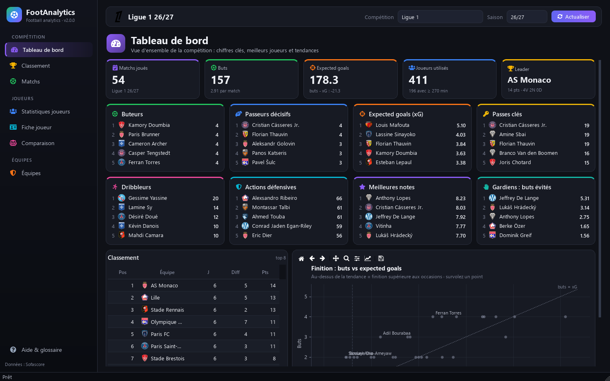

## Fonctionnalités

| Section | Contenu |
|---|---|
| **Tableau de bord** | Chiffres clés de la compétition, top 5 par métrique (buts, xG, passes clés, dribbles, actions défensives, notes, gardiens), finition buts vs xG |
| **Classement** | Classement avec logos, **classement xG** (points attendus xPts, chance / malchance, PPDA officiel), attaque vs défense, points par match |
| **Matchs** | Par journée : stats d'équipe par période (match / mi-temps) et catégorie, carte des tirs avec xG, xG cumulés minute par minute, courbe de domination, ~70 stats individuelles en 8 groupes, heatmaps, positions moyennes, chronologie |
| **Pronostics** | Probabilités 1 / N / 2 des prochains matchs (modèle de Poisson sur les xG), matrice des scores, simulation de n'importe quelle affiche, **fiabilité du modèle** (rejoué sur les matchs passés : taux de réussite, score de Brier, calibration) |
| **Statistiques joueurs** | ~110 métriques en 11 catégories, filtres poste / équipe / temps de jeu, mode par 90 min, classement graphique, export Excel/CSV |
| **Fiche joueur** | Identité (âge, pied, valeur, contrat), profil en centiles vs joueurs du même poste, forme match par match, **profils similaires** (joueurs statistiquement les plus proches), **carrière** saison par saison, toutes les stats avec rang au poste, **liste de suivi**, **export PDF** |
| **Comparaison** | Radar en centiles de deux joueurs, nuage de points libre, référentiel compétition ou **5 grands championnats** |
| **Recherche avancée** | Joueurs remplissant plusieurs critères (centiles par poste), compétition ou 5 grands championnats, recherches enregistrables |
| **Indices personnalisés** | Scores composés de métriques pondérées (Créateur, Finisseur, Récupérateur… ou les vôtres), classement et export |
| **Équipes** | ~75 métriques d'équipe dont ce qui est concédé à l'adversaire, PPDA, **comparaison de deux équipes** (radar), **forme** (xG glissants), **bilan domicile / extérieur** |
| **Aide & paramètres** | Glossaire, thème sombre / clair, vérification des mises à jour, gestion du cache |

Graphiques interactifs : survol = détail, barre d'outils = zoom et export PNG.
Double-clic sur un joueur dans n'importe quel tableau → sa fiche. **Ctrl+K** : recherche globale (joueurs, équipes, pages).
Matchs en cours actualisés automatiquement (mode direct). Rapports PDF de fiches joueurs et de matchs.
La compétition, la saison et la page ouvertes sont retrouvées au lancement suivant ; l'appli signale les nouvelles versions publiées.

<p>
  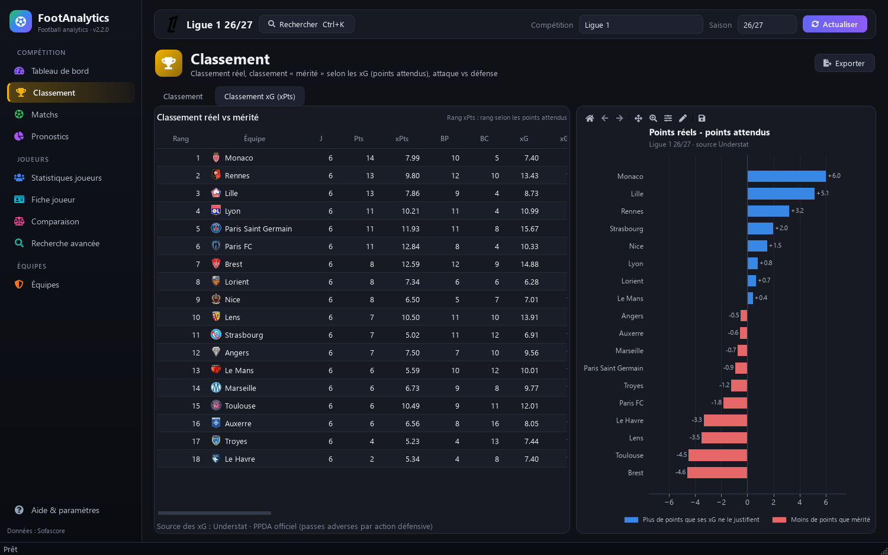
  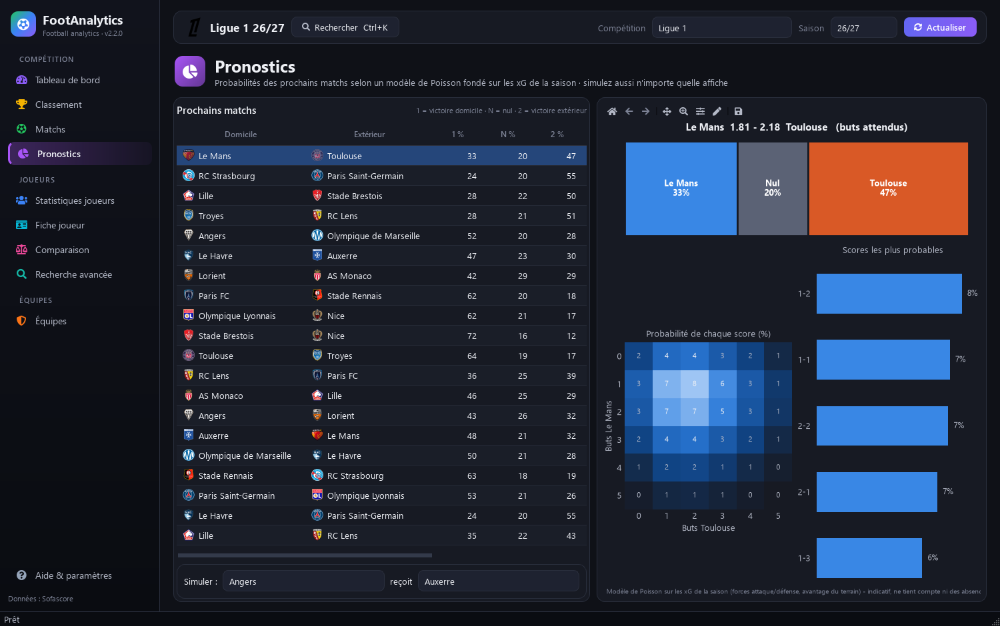
  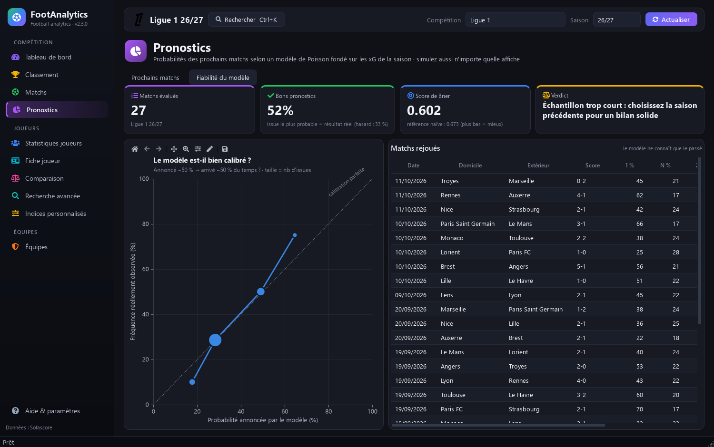
  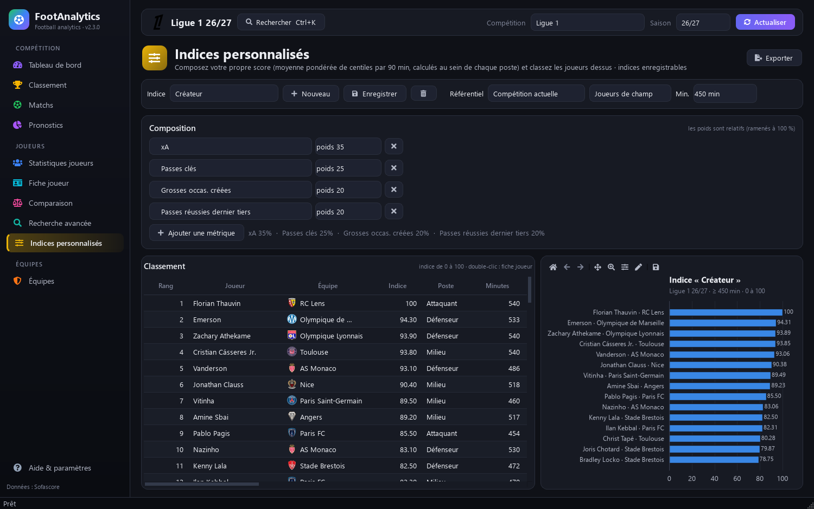
  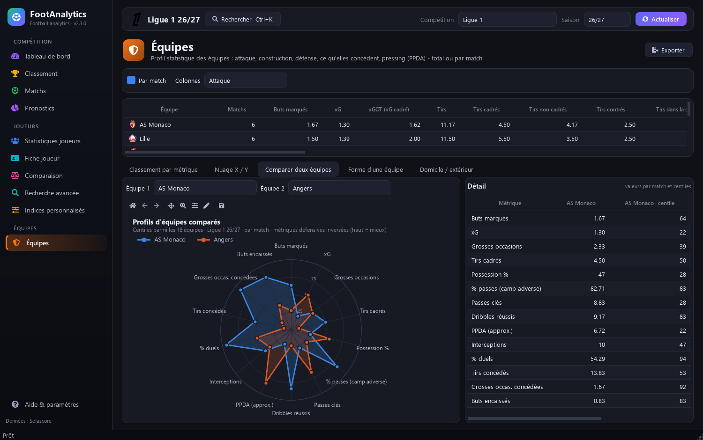
  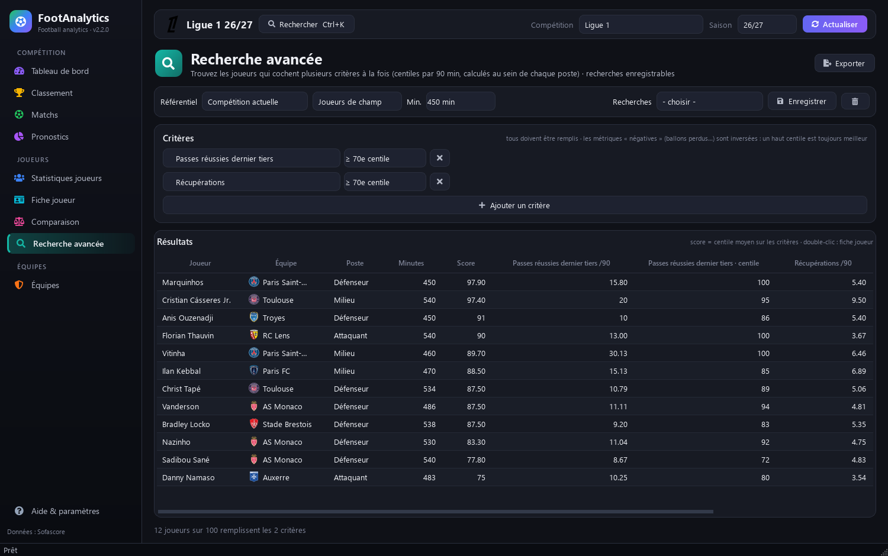
  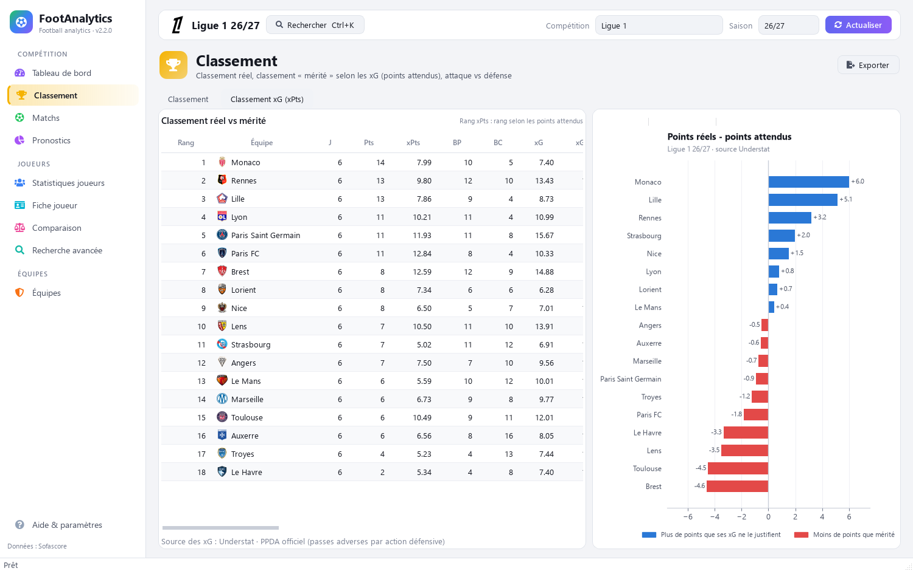
  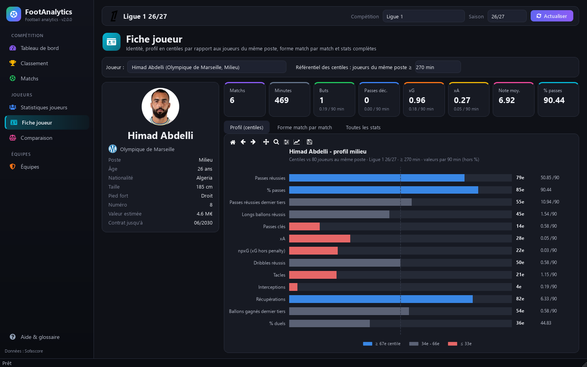
  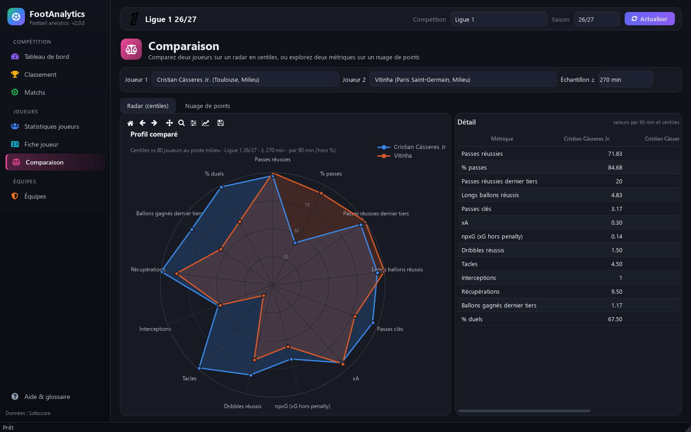
  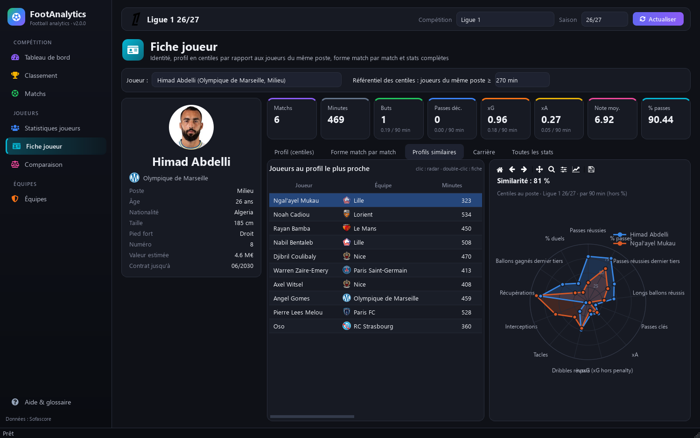
  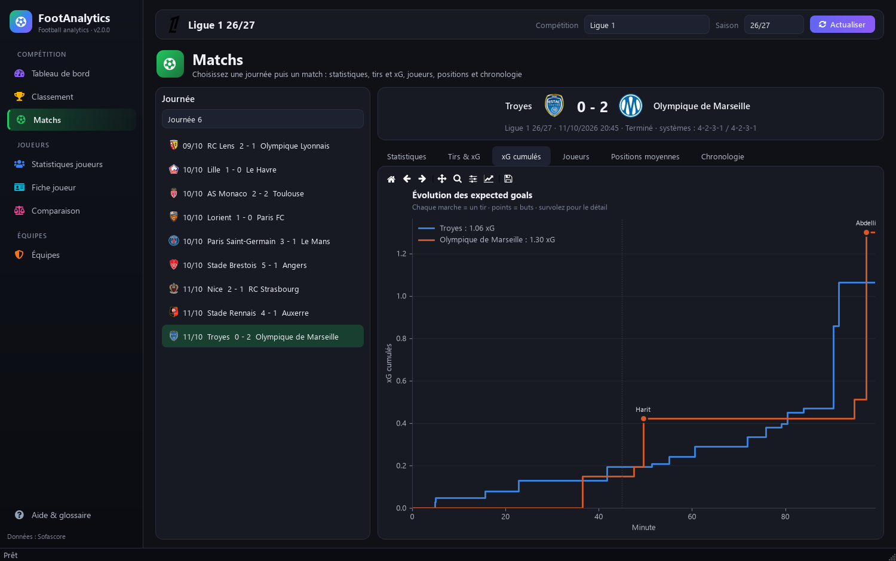
  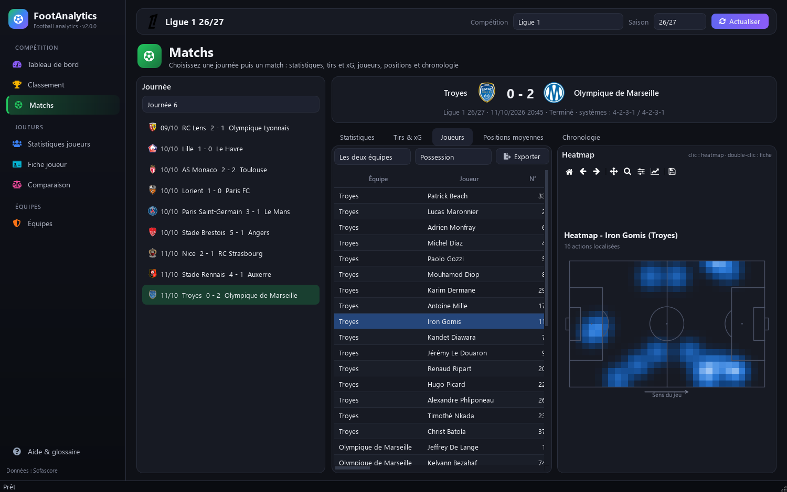
  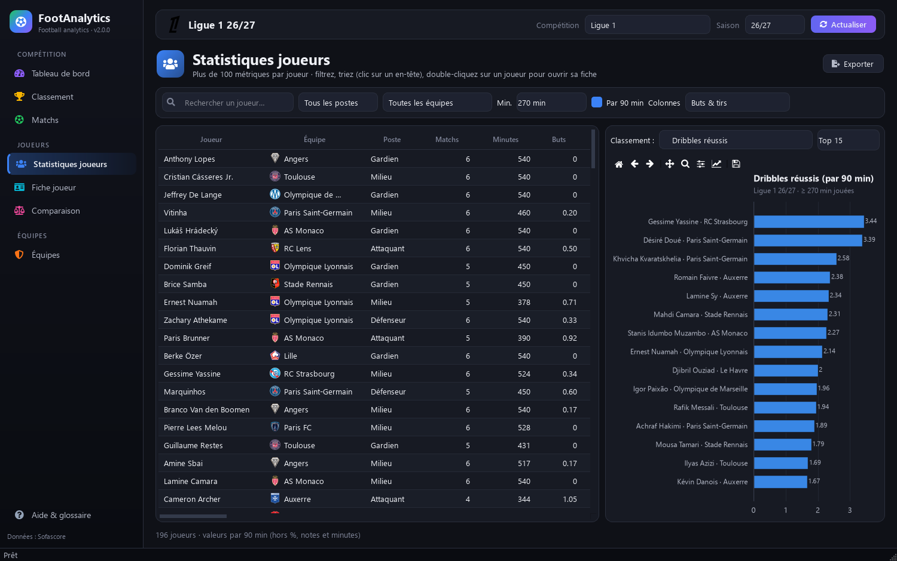
</p>

## Installation

### Installeur (recommandé)
Télécharger `FootAnalytics-Setup-<version>.exe` dans les [Releases](../../releases) (ou l'artefact du dernier
build dans l'onglet *Actions*) et le lancer : installation sans droits administrateur, raccourcis menu Démarrer
et Bureau, désinstallation depuis les paramètres Windows. Une version portable (`.zip`) est aussi fournie.
Aucune installation de Python nécessaire.

### Depuis les sources
```powershell
python -m venv .venv
.\.venv\Scripts\python.exe -m pip install -r requirements.txt
.\.venv\Scripts\python.exe main.py
```

### Construire l'application
```powershell
powershell -ExecutionPolicy Bypass -File build.ps1
# -> dist\FootAnalytics\ (application), dist\FootAnalytics-<version>-portable.zip,
#    dist\FootAnalytics-Setup-<version>.exe (si Inno Setup 6 est installé : winget install JRSoftware.InnoSetup)
```
Le workflow GitHub Actions (`.github/workflows/build.yml`) le fait automatiquement à chaque push sur `main` ;
pousser un tag `v*` (ex. `git tag v2.2.0 && git push --tags`) publie l'installeur et le zip dans une Release.
L'icône se régénère avec `python tools\make_icon.py`.

## Tests

```powershell
.\.venv\Scripts\python.exe -m pip install -r requirements-dev.txt
.\.venv\Scripts\python.exe -m pytest -q                 # hors ligne, sur des réponses API enregistrées
$env:FOOT_LIVE="1"; .\.venv\Scripts\python.exe -m pytest tests/test_live.py   # contre la vraie API
.\.venv\Scripts\python.exe -m tests.record_fixtures      # ré-enregistrer les réponses de référence
```

Les tests vérifient notamment que chaque métrique demandée à l'API est toujours renseignée :
si Sofascore renomme un champ, le test échoue et indique lequel. Ils tournent à chaque push (GitHub Actions)
avant la construction de l'exe.

## Sécurité

- Données reçues d'Internet jamais interprétées comme du HTML dans l'interface ; exports Excel/CSV protégés
  contre l'injection de formules ; lien de mise à jour vérifié (Releases de ce dépôt uniquement).
- Cache en JSON uniquement (jamais de code exécutable), écrit de façon atomique, purgé automatiquement.
- Dépendances vérifiées avec `pip-audit` ; build GitHub en lecture seule hors publication, actions figées
  sur des commits précis.

## Données

Sources : API JSON publique utilisée par le site sofascore.com (non officielle, sans clé), interrogée via
`curl_cffi` qui imite un navigateur ; **Understat** pour les xG par match, xPts et PPDA des 5 grands championnats,
et comme source de secours si Sofascore est indisponible.

- **Usage personnel / expérimental uniquement** : l'API n'est pas documentée et ses conditions
  n'autorisent pas un usage commercial.
- Elle peut changer ou bloquer sans préavis : tout l'accès réseau est isolé dans `footapp/api/sofascore.py`.
- Cache disque dans `%LOCALAPPDATA%\FootAnalytics\cache` : matchs terminés conservés définitivement,
  le reste de 15 min à 12 h. Le bouton « Actualiser » vide le cache temporaire.

## Structure

```
main.py                       point d'entrée
footapp/
  config.py                   compétitions, catalogue des métriques et libellés
  api/sofascore.py            client HTTP + cache disque (JSON et images)
  api/understat.py            client Understat (xG par match, xPts, PPDA, secours)
  data.py                     appels API -> DataFrames pandas (+ métriques dérivées)
  analysis.py                 par 90 min, centiles, profils similaires, recherche, Poisson (xPts, pronostics)
  updates.py                  vérification des Releases GitHub
  ui/
    main_window.py            fenêtre : navigation latérale + barre de contexte
    state.py                  état partagé (compétition, classement, joueurs)
    theme.py                  couleurs, feuille de style Qt, style matplotlib
    widgets.py                cartes, tuiles, tableaux, graphiques, images, tâches de fond
    charts.py                 tous les graphiques (matplotlib / mplsoccer)
    report.py                 rapports PDF
    palette.py                recherche globale Ctrl+K
    pages/                    une page par section
tests/                        tests pytest + réponses API enregistrées (fixtures/api.json.gz)
```

**Ajouter une compétition** : `(nom, id)` dans `COMPETITIONS` (l'id figure dans l'URL Sofascore du tournoi).
**Ajouter une métrique joueur ou équipe** : une ligne dans `PLAYER_METRICS` / `TEAM_METRICS`.
